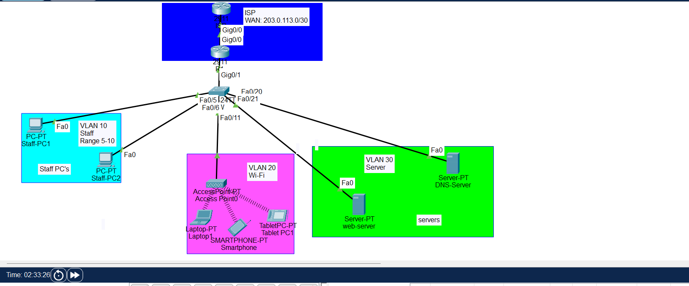
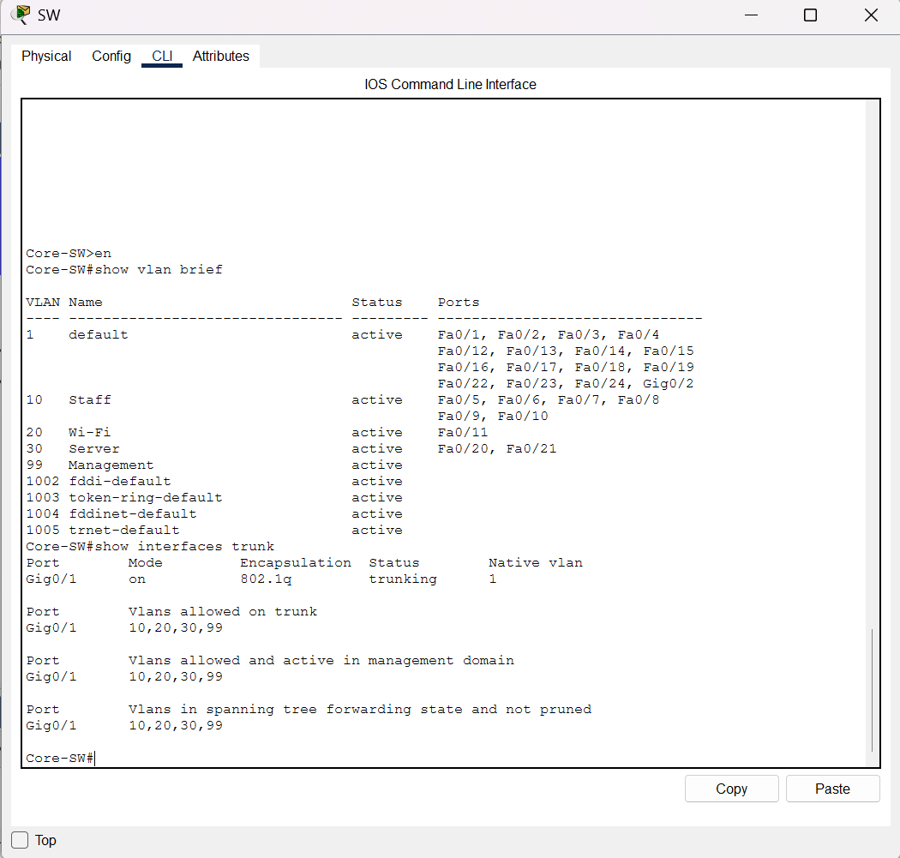
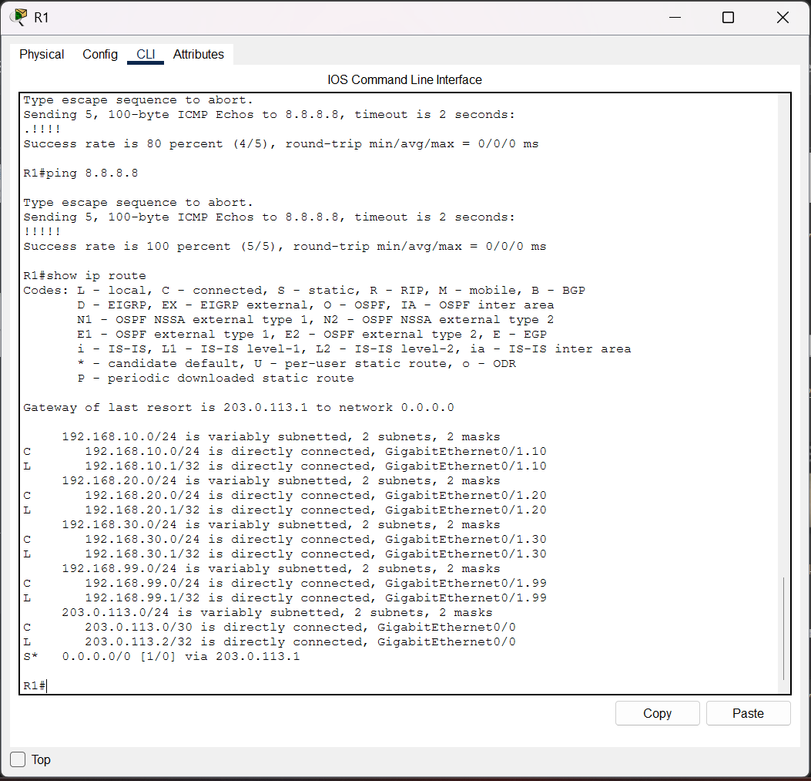
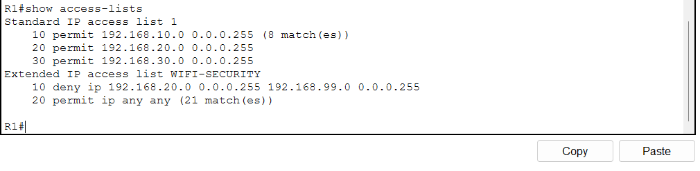
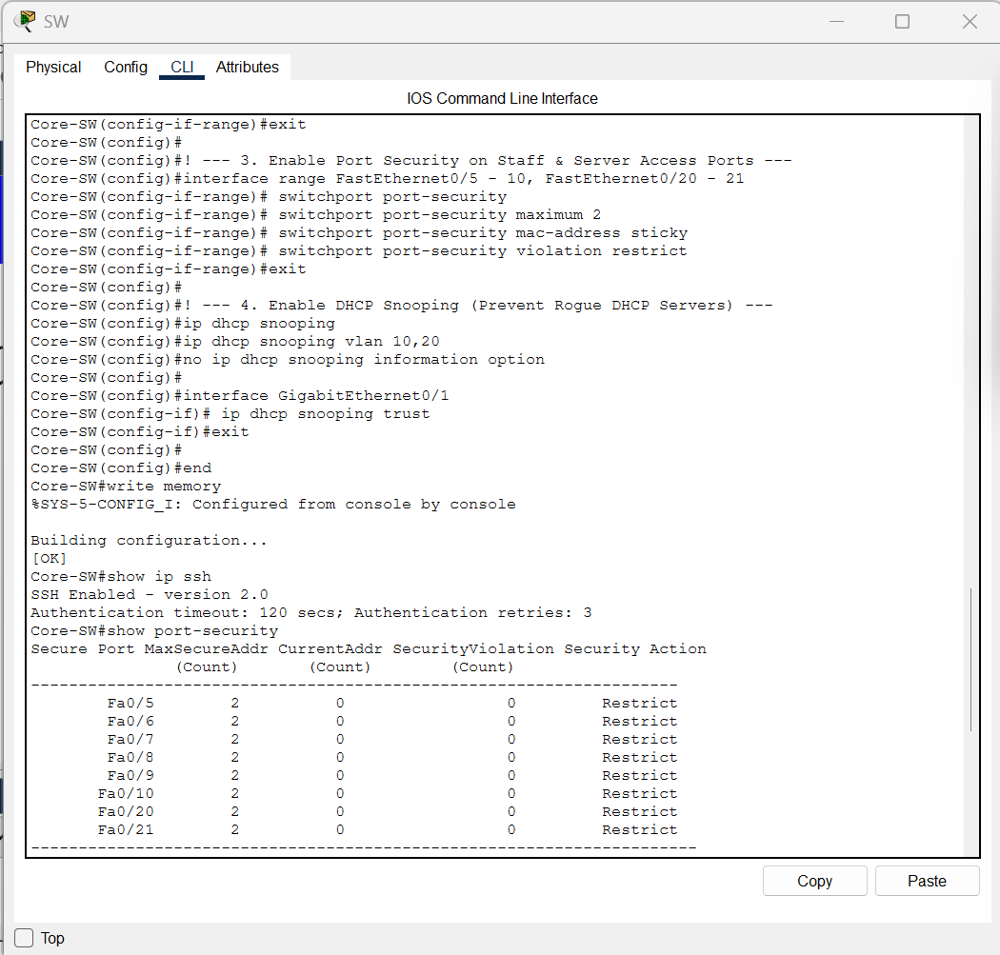
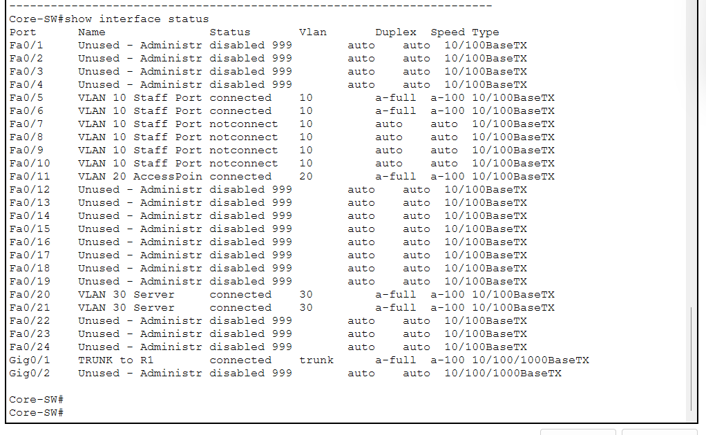
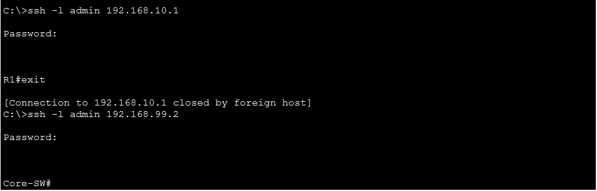
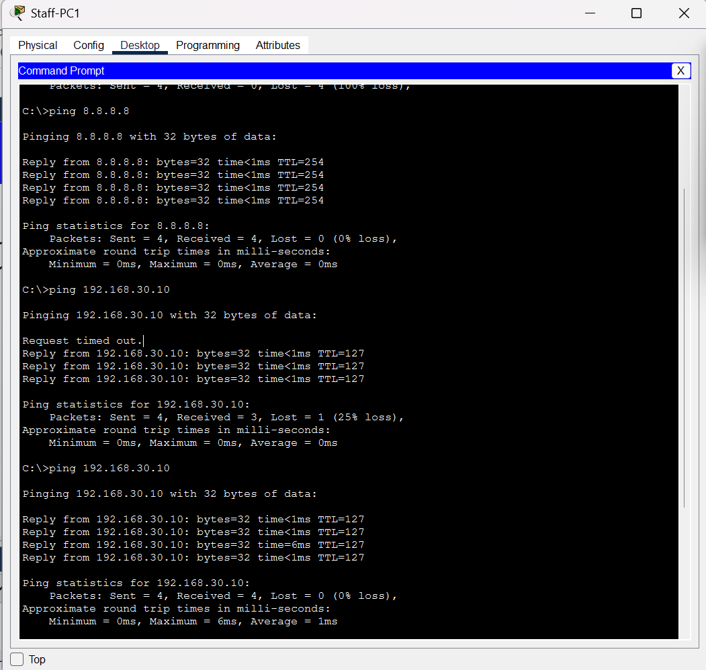
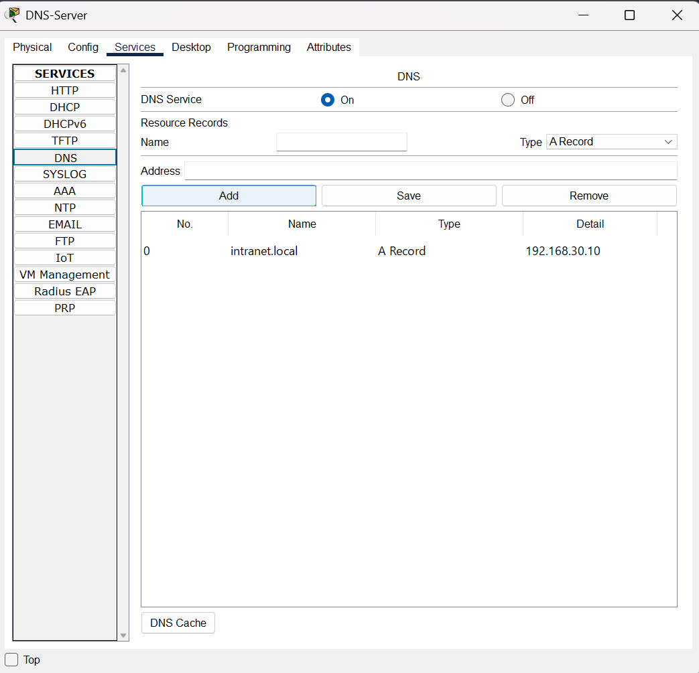
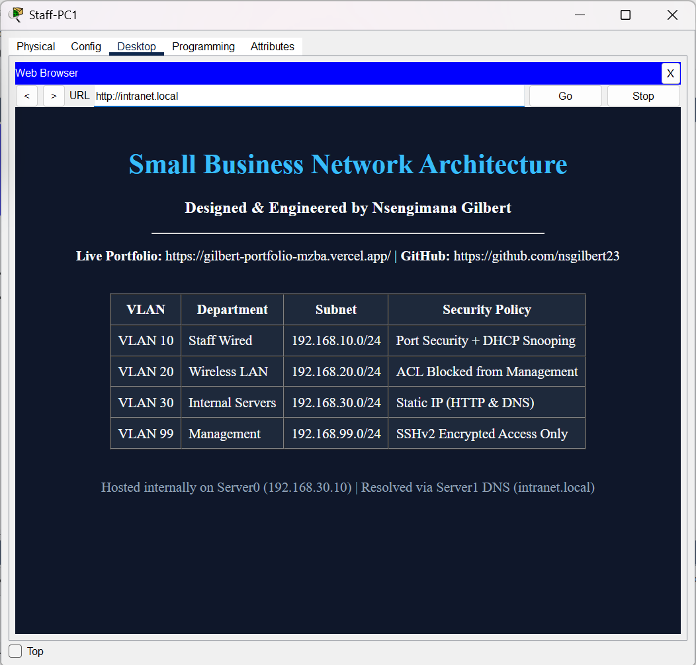

# Secure Small Business Network Architecture (Cisco Packet Tracer)

**Designed & Engineered by:** Nsengimana Gilbert  
**Portfolio:** [gilbert-portfolio-mzba.vercel.app](https://gilbert-portfolio-mzba.vercel.app/) | **GitHub:** [@nsgilbert23](https://github.com/nsgilbert23)

---

## Project Overview

This project presents a segmented, security-hardened **Small Business Network Architecture** built and validated in **Cisco Packet Tracer**. The design follows a hierarchical enterprise model separating untrusted WAN traffic, edge routing/NAT, Layer 2 VLAN segmentation, wireless access, internal application servers, and out-of-band network management.

### Key Architectural Highlights
* **VLAN Segmentation & Router-on-a-Stick:** Isolated wired staff, wireless users, internal servers, and management traffic across four dedicated 802.1Q VLANs (`10`, `20`, `30`, `99`).
* **Edge NAT Overload (PAT) & WAN Routing:** Configured Port Address Translation on a Cisco 2911 edge router (`R1`) to translate internal RFC 1918 subnets (`192.168.x.0/24`) behind a single public WAN IP (`203.0.113.2/30`).
* **Zero-Trust Access Control Lists (ACLs):** Applied inbound extended ACLs (`WIFI-SECURITY`) on the wireless subinterface to block wireless clients from reaching the switch management plane (`VLAN 99`).
* **Layer 2 Switch Hardening:** Implemented sticky MAC **Port Security**, **DHCP Snooping** with trusted uplink enforcement, and **VLAN 999 blackholing** with administrative shutdown on all unused switch ports.
* **Encrypted Remote Administration:** Disabled unencrypted Telnet and enforced **SSHv2** with 1024-bit RSA encryption and local privilege-15 authentication across both `R1` and `Core-SW`.
* **Internal DNS & Intranet Web Hosting:** Deployed dedicated internal `DNS-Server` (`192.168.30.11`) and `web-server` (`192.168.30.10`) instances resolving `http://intranet.local` across all wired and wireless subnets.

---

## Network Topology



---

## IP Addressing & VLAN Design

| VLAN ID | Department / Zone | Network Subnet | Default Gateway (`R1`) | IP Assignment | Switch Ports (`Core-SW`) |
| :--- | :--- | :--- | :--- | :--- | :--- |
| **WAN** | ISP External Link | `203.0.113.0/30` | `203.0.113.1` (`ISP`) | Static (`203.0.113.2`) | `R1 Gig0/0` ↔ `ISP Gig0/0` |
| **VLAN 10** | Staff Wired (`Staff`) | `192.168.10.0/24` | `192.168.10.1` (`Gig0/1.10`) | DHCP (`STAFF_POOL`) | `Fa0/5 – Fa0/10` |
| **VLAN 20** | Wireless LAN (`Wi-Fi`) | `192.168.20.0/24` | `192.168.20.1` (`Gig0/1.20`) | DHCP (`WIFI_POOL`) | `Fa0/11` (`AccessPoint0`) |
| **VLAN 30** | Internal Servers (`Server`) | `192.168.30.0/24` | `192.168.30.1` (`Gig0/1.30`) | Static (`.10`, `.11`) | `Fa0/20 – Fa0/21` |
| **VLAN 99** | Infrastructure Management | `192.168.99.0/24` | `192.168.99.1` (`Gig0/1.99`) | Static (`192.168.99.2` SVI) | `Gig0/1` (802.1Q Trunk) |
| **VLAN 999** | Unused / Blackhole Ports | *Unassigned* | *None* | Administratively Down | `Fa0/1–4`, `12–19`, `22–24`, `Gig0/2` |

### Server & Infrastructure Inventory
* **`R1` (Cisco 2911):** Edge Router, Inter-VLAN Gateway, DHCP Server, PAT/NAT Edge, and ACL Policy Enforcement.
* **`Core-SW` (Cisco 2960-24TT):** Access/Distribution Layer 2 Switch (`192.168.99.2`).
* **`ISP` (Cisco 2911):** Simulated Service Provider Router hosting public loopback `8.8.8.8/32`.
* **`web-server` (`192.168.30.10`):** Internal HTTP Server hosting the company intranet portal.
* **`DNS-Server` (`192.168.30.11`):** Internal DNS Server resolving `intranet.local` (`A Record` → `192.168.30.10`).

---

## Implementation & Verification

### 1. Layer 2 VLAN Segmentation & 802.1Q Trunking
`Core-SW` segments end-user workstations, wireless access points, and internal servers into isolated broadcast domains while trunking tagged frames (`VLAN 10, 20, 30, 99`) to `R1` over `GigabitEthernet0/1`.



---

### 2. Inter-VLAN Routing, WAN Connectivity & Security ACLs
`R1` routes traffic between all internal subinterfaces (`Gig0/1.10`, `.20`, `.30`, `.99`), translates outbound internet requests via PAT (`access-list 1`), and enforces `WIFI-SECURITY` inbound on `Gig0/1.20` to prevent wireless clients from accessing switch management interfaces (`192.168.99.0/24`).





---

### 3. Switch Port Hardening, DHCP Snooping & SSHv2 Management
To mitigate Layer 2 and unauthorized physical access risks:
* **Port Security:** Enabled sticky MAC learning (`maximum 2`, `violation restrict`) on staff and server access ports (`Fa0/5–10`, `Fa0/20–21`).
* **DHCP Snooping:** Enabled on `VLAN 10` and `VLAN 20`, trusting only uplink trunk `Gig0/1` to block rogue DHCP servers.
* **Unused Port Mitigation:** Assigned all unused interfaces to `VLAN 999` (`UNUSED_PORTS`) and placed them in `shutdown` state.
* **SSHv2 Enforcement:** Configured 1024-bit RSA keys and restricted VTY lines on both `R1` and `Core-SW` to `transport input ssh`.







---

### 4. End-to-End Connectivity, Internal DNS & Web Portal
Wired (`Staff-PC1`, `Staff-PC2`) and wireless (`Laptop1`, `Smartphone`, `Tablet PC1`) clients dynamically lease IPv4 addresses and internal DNS settings (`192.168.30.11`) from `R1`, reach external WAN targets (`8.8.8.8`) via NAT, and resolve the internal web portal at `http://intranet.local`.







---

## Repository Files

* [`configs/R1-running-config.txt`](configs/R1-running-config.txt) — Complete Cisco IOS configuration for Edge Router `R1`
* [`configs/Core-SW-running-config.txt`](configs/Core-SW-running-config.txt) — Complete Cisco IOS configuration for `Core-SW`
* [`configs/ISP-running-config.txt`](configs/ISP-running-config.txt) — Simulated ISP Router configuration
* [`topology/Small-Business-Network.pkt`](topology/Small-Business-Network.pkt) — Cisco Packet Tracer lab file

---

## How to Run This Lab

1. Clone this repository:
   ```bash
   git clone [https://github.com/nsgilbert23/small-business-network-architecture.git](https://github.com/nsgilbert23/small-business-network-architecture.git)
   ```
2. Open `topology/Small-Business-Network.pkt` in **Cisco Packet Tracer** (v8.2 or newer).
3. Test SSH management from `Staff-PC1` (`Desktop → Command Prompt`):
   ```cmd
   ssh -l admin 192.168.10.1
   ssh -l admin 192.168.99.2
   ```
   *(Default lab credentials: Username `admin` / Password `AdminPa55!` / Enable Secret `CiscoEnpa55!`)*
4. Open **Web Browser** on any wired or wireless client and navigate to `http://intranet.local`.
